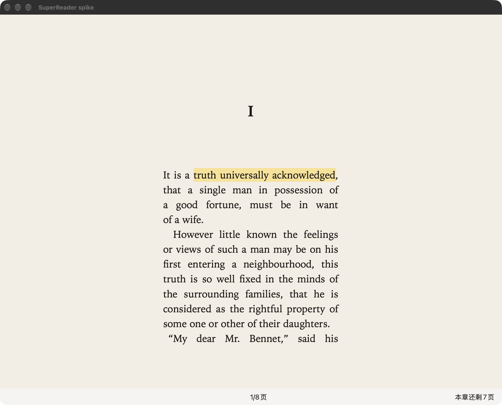
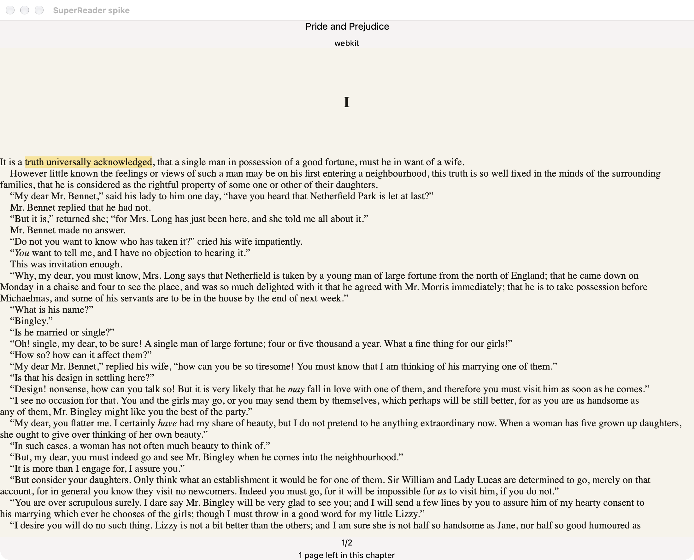

# SuperReader

[](https://github.com/realmorrisliu/SuperReader/actions/workflows/ci.yml)

SuperReader is an agent-native PDF and EPUB reader for macOS, written in Rust on [NSH](https://nsh.dev). The goal is Apple Books–level reading UX with first-class hooks for agents: search, summarization, and tooling over your library and annotations.





## Status

**Pre-alpha.** This repository is a spike shell and verification harness, not a shipping app. Today it includes a macOS reader window, PDF pages via pdfium-render, EPUB pages via WKWebView with an owned Knuth–Plass justification pass and on-disk line-break cache, trim presets, and `scripts/verify` to exercise real UI timings and layout checks. EPUB may move to a pure-Rust typesetter later; see [docs/design/north-star.md](docs/design/north-star.md) and [docs/roadmap.md](docs/roadmap.md).

## Build and run

You need **Rust 1.98.1** (`rust-toolchain.toml` at the repo root), **macOS** for the spike shell, and [just](https://github.com/casey/just) for everyday tasks.

1. Toolchain (from the repository root):

   ```sh
   rustup toolchain install 1.98.1
   rustup default 1.98.1
   ```

2. Fetch public fixtures and the pdfium dylib (for PDF and full-shell builds):

   ```sh
   spikes/fetch-fixtures.sh
   ```

   Defaults: books under `/tmp/superreader-fixtures`, pdfium under `/tmp/pdfium`. Override with `SPIKE_FIXTURES` and `SPIKE_PDFIUM`.

3. Build and test:

   ```sh
   just build
   just test
   ```

   Release binary: `target/release/spike-shell`.

4. Full UI verification (release build, NSH **0.4.0** on `PATH`, calm machine):

   ```sh
   just verify
   ```

   See [docs/nsh.md](docs/nsh.md) for the NSH pin. Use `just verify -- --subset cache` for a shorter cache-focused pass.

Other tasks: `just fmt`, `just lint`, `just doc`, `just deny`, `just clean-worktrees`. See [docs/tooling.md](docs/tooling.md).

## Repository layout

| Path | Purpose |
|------|---------|
| `spikes/` | Rust crates (`report`, `epub`, `pdf`, `shell`, `measure`); workspace root is repo `Cargo.toml` |
| `justfile` | Entry point for build, test, lint, deny, verify |
| `scripts/verify` | macOS verification driver (`nsh test`, window/chrome/reading checks) |
| `scripts/cleanup-worktrees.sh` | Remove merged agent worktrees (morris-mac) |
| `docs/design/` | North star, justification census, references |
| `docs/prototypes/` | Recorded UI screenshots and clips from the spike |
| `docs/verify/` | Verification summaries and replay artifacts |
| `.cursor/skills/` | Cursor agent skill for running verify (optional for contributors) |

## Further reading

- [North star](docs/design/north-star.md)
- [Roadmap](docs/roadmap.md)
- [NSH 0.4.0 in this shell](docs/nsh.md)

## License

Licensed under either of

- Apache License, Version 2.0 ([LICENSE-APACHE](LICENSE-APACHE) or http://www.apache.org/licenses/LICENSE-2.0)
- MIT license ([LICENSE-MIT](LICENSE-MIT) or http://opensource.org/licenses/MIT)

at your option.

### Contribution

Unless you explicitly state otherwise, any contribution intentionally submitted for inclusion in the work by you, as defined in the Apache-2.0 license, shall be dual licensed as above, without any additional terms or conditions.
