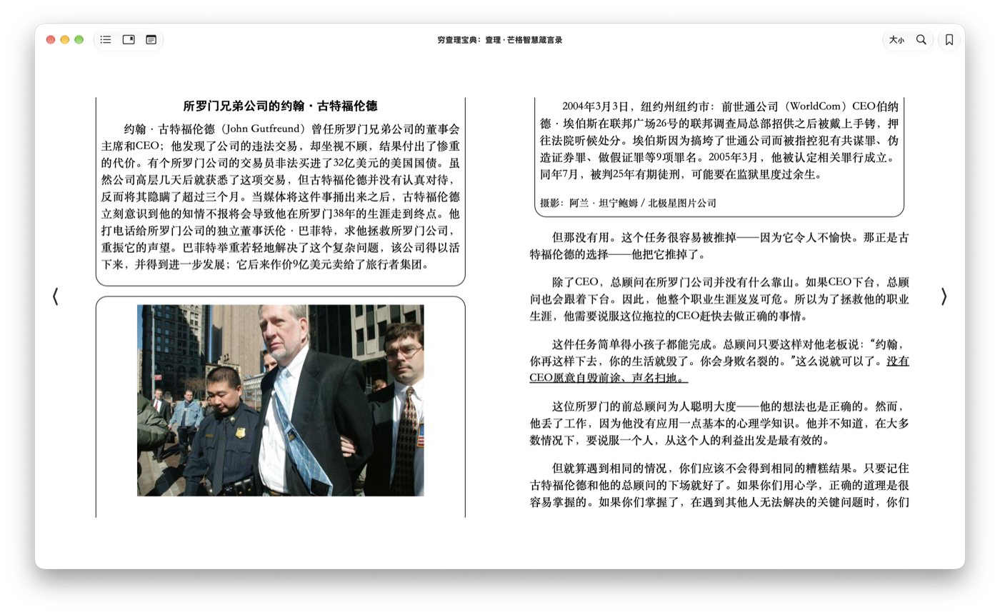

# Goals and hard principles

SuperReader replaces Apple Books for Morris. The agent features matter equally with reading. Ask, explain, or translate a selection. Summarize a chapter. Search across the library. Let other agents read the library and the notes.

The product is opinionated. Settings stay few, and Morris's taste decides.

## How we work

Every line of work first lands the thinnest end-to-end path on main: a real AppKit window, real data, from input to screen. Then it thickens layer by layer. No big PRs accumulating on a branch.

One PR does one independently verifiable thing and merges as soon as it is verified. Push at least at every visible step, even as a draft.

Every step says what is still missing from the final bar: Apple Books-level UI, typesetter gate B, and the library targets that beat dalibre. Acceptance criteria are never lowered, only split into smaller steps.

Every change Morris can see gets screenshots.

The icon flow is in `CONTRIBUTING.md`, under Icons.

Verify runs on the Mac take `/tmp/superreader-verify.lock` and wait until the 1-minute load average is under 8. The summary records that load at the start and at the end. A timing check that failed while the load was high is run again under that rule before it is reported.

## Hard principles

No theme switching, and no night mode, ever. A reader with night mode is unacceptable.

Single-page reading only. There is no two-page spread, and there is no setting that turns one on.

The liked reference is Apple Books on one page of 《穷查理宝典》. The toolbar carries the book title. The footer shows the page as `590/1146` and the pages left in the chapter.

The disliked reference is the same book as a two-page spread.

## Stack

The app is Rust on NSH, pinned at v0.4.0, macOS first. PDF pages ship `libpdfium.dylib` through pdfium-render. EPUB pages use the system WKWebView. That EPUB choice is under re-evaluation as of 2026-11-10. The headless typesetter in `crates/superreader-typeset` is the first step. The reader stays on WKWebView until phase 1 of the typesetter gate passes. LLM calls go through [openrouter-rs](https://github.com/realmorrisliu/openrouter-rs). Annotations live in SQLite. The full-text index is tantivy. AGPL dependencies stay out, including MuPDF. The GPL `epub` crate stays out. EPUB parsing uses rbook.

## NSH alignment

Recorded on 2026-11-10, against the 0.4.0 docs. The shell follows the Rust app in [Project structure](https://nsh.dev/docs/project-structure.md), the window and menu APIs in [nsh/desktop](https://nsh.dev/modules/nsh-desktop.md), and the headless checks in [Testing](https://nsh.dev/docs/testing-and-trace.md). The menu shape is the `examples/desktop` application menu. What still sits on objc2, and why, is in `docs/nsh.md`.

Patterns we follow:

- `spikes/shell/nsh.json` is the app root. `rust` is `.` and `root` is `SpikeApp`. `lib.rs` registers that component with `#[native_module]` and `#[component]`, as the Rust example does.
- The window calls `set_title_bar(TitleBarStyle::Hidden, Some(px(48)))`. A height above 44 points selects regular macOS chrome: the empty unified toolbar, a transparent title bar, and a full-size content view. NSH hides the toolbar it owns while the window is in full screen, and shows it again afterwards.
- The paper is Books-white `#ffffff`, with no cream or yellow paper. It is the root view background. NSH copies an opaque view that fills the window onto the surface layer, so the chrome and the toolbar blend into the page the way Apple Books does.
- The menu is the documented `AppMenu` pattern. An `effect` calls `set_application_menu` and rebuilds it when the trim signal changes. On macOS the first menu is the app menu of roles (About, Hide, Hide Others, Quit). Edit is the edit roles, including Select All. View items use `.checked` against the current trim. The Window menu's full screen item is `MenuRole::ToggleFullScreen`.
- `spikes/shell/shell.test.tsx` imports `expect`, `open`, and `test` from `nsh/test`. Three checks use `toContain`. The title check uses `not.toContain` for `SuperReader spike`. `scripts/verify` runs them with `nsh test`.

Where we differ, on purpose:

- The book title is an `NSTextField` in the content view, and it fades with the traffic lights. The documented title bar is an NSH view with `window_drag` and padding from `title_bar().left`. That row stays hidden while an EPUB is open, because the title the reader sees has to fade.
- A drag on the page mat uses `performWindowDragWithEvent` on the native stage view. `window_drag` marks NSH views. The stage view keeps the click so a drag on the page can select text.
- The fitted window uses AppKit `setFrame`. The fit math reads `visibleFrame`, whose origin is the bottom left. `set_frame` measures from the top left of the primary screen, with y growing down.
- `SPIKE_FULLSCREEN` calls `toggleFullScreen` on the timer that owns the view. `toggle_full_screen` has to run under an NSH owner, and that timer has none. The menu item stays the role.
- The window is ordered front with `activateIgnoringOtherApps`. `order_front` calls `activate`.
- `FullScreenPrimary` is added to the window's collection behavior. `set_level` is the NSH call that sets collection behavior, and it replaces the behavior with `MoveToActiveSpace`.
- The titlebar hairline is cleared with `setTitlebarSeparatorStyle`. The traffic lights fade by setting the alpha of `standardWindowButton`. NSH exposes neither.
- EPUB pages are a system WKWebView, and PDF pages are a pdfium bitmap. The page is outside NSH's `WebView`. The EPUB half is under re-evaluation. The first native step is the headless typesetter, and the Mac glyph-run view is not built yet. PDF via pdfium-render stays.
- `main.rs` calls `run_app` so the spike can register the native stage and set the opening size. Verify launches that binary. `nsh test` still opens the app the documented way, from `nsh.json`.

## Agents and alan

Other agents, alan included, reach the library and the notes through a `superreader` command that prints JSON, plus a skill. An MCP server is a thin wrapper later, and only for clients that cannot run a terminal.

alan's bash runs under a macOS Seatbelt sandbox that denies writes outside mounted directories. A `superreader` write is applied by the running SuperReader app. The command does not open the database itself.

Picked on 2026-11-03. SuperReader owns the library, the SQLite annotations, tantivy, the comment threads, and the comment UI. alan is not linked into the reader process, and SuperReader does not speak alan's socket protocol. On `@alan` in a comment, SuperReader spawns a fresh one-shot `alan` process and pipes stdin. The body is the passage, the user's note, the earlier comments in the thread, and the new question. SuperReader reads stdout and writes that text into its own SQLite as alan's reply comment. The spawn does not pass `--resume`. The annotation id and the thread id live in SuperReader. The reply arrives whole, not streamed, so the comment shows a thinking state until the reply lands.

The reading form shows highlights, notes, and agent responses in an annotation margin. The library form's chat panel is a separate region. The margin's gap, collision stacking, and the way back to the free-form chat wait for a mockup Morris approves. The layout reference is `docs/design/shell/spec.md`. The spike still keeps a stable anchor that a comment thread can hang on. Shell slices do not embed alan.

alan needs a launch flag so a reader-spawned run does not rewrite alan's global root-rollout pointer. That flag is an external dependency. See the roadmap. This repository does not patch alan.

## Icons

IconMCP is the only icon library. The global parameters are outline, stroke 1.25, and radius 2. Solid is for a selected or active state only.

The shell rasterizes each SVG at runtime with resvg into a template image. AppKit tints that image for the window appearance. A selected icon can use the accent color. The SVG bytes are in the binary, so a run does not contact IconMCP.

The contents control is the first item in the unified toolbar. It is inserted once the traffic lights are shown, which leaves it 26pt after the zoom button and centered on that button. Inserting it while the lights are faded parks it on the minimize button, and it stays there. The glyph is IconMCP `generic` / `list`, outline, stroke 1.25, radius 2. S1 keeps this glyph as the sidebar toggle. While the sidebar is shown, the glyph sits on the sidebar's top row and the toolbar does not repeat it. While the sidebar is hidden, this toolbar placement still applies.

The paper is Books-white `#ffffff`. There is no night mode. A dark window appearance paints a template icon light, so the icon disappears on that paper. The light appearance is the one that sits on the page.

Attribution for IconMCP and each set in use is in `assets/icons/NOTICE`.

## App shell (2026-11-11)

Morris approved the shell on 2026-11-11, and it comes before any other feature. The layout reference is `docs/design/shell/spec.md`. The slices are S1 through S5, in that order, in the spec and in `docs/roadmap.md`.

The window base is a light gray macOS vibrancy field. No divider sits between the sidebar, the card, and the right region.

One white card fills the area between the sidebar and the right region. The radius is 12 points. The inset is 6 points on every side, with a soft shadow. Immersive reading sets the inset to 0, hides the gray field, and takes the card to the window edges.

Full is the launch form. The sidebar is shown, the card is the library, and the right region is the chat panel. The chat panel is 320 points wide, open at launch, and sits on the gray base. Page and panel is the reading form. Opening a book hides the sidebar, puts the page in the card, and replaces the chat panel with the annotation margin. Immersive reading shows the card edge to edge.

The annotation margin anchors each highlight, note, and agent response to the line it refers to, aligned with that line, and the notes move with the page. Asking about a selection adds one of those notes. The gap, the stacking, and the way back to the free-form chat wait for Morris's mockup. S3 does not start before that approval.

The sidebar is the version B text rows, 220 points wide. The icon rail is rejected. The traffic lights and the sidebar toggle share the top row.

S1 removes the empty-window Open button, the `open -a` and Open With checks, and the bare shelf screen. It does not repair them. `spikes/library` stays.

## Left bar measurement (2026-11-10)

The spike still sizes the whole left bar from the traffic lights. The checks in `.cursor/skills/verify-superreader/features/sidebar.md` score that bar until S1 replaces it. The shell keeps the measurement and applies it to the top row's left inset. The sidebar width is then 220 points.

The measured inset centers the traffic lights, with the same space on the left and on the right.

The width comes from AppKit at runtime. It is the zoom button's right edge plus the close button's left edge, after those frames are converted to window coordinates. The left gap is the close button's left edge. The right gap is the bar width minus the zoom button's right edge. Those two gaps are equal. The width is not a hardcoded estimate.

The buttons are read after the title bar has laid them out. The width is measured again when the window is created, when the toolbar style changes, when immersive reading starts or ends, and when the window enters or leaves full screen. A resize does not change it.

The spike centers the page, and the footer inside it, in the area from the bar's right edge to the window's right edge. That holds after a resize and after leaving immersive reading. The book title stays centered on the full window. The toolbar title sits in the middle of the window, and the toolbar controls stay in a group just after the traffic lights. S1 puts the page in the card. The card then fills the area between the sidebar and the right region.

## Decision log

- 2026-11-03. No night mode, and no theme switching.
- 2026-11-03. Single-page reading only. The spread in the disliked reference is out.
- 2026-11-03. alan is a one-shot process with piped stdin and a whole stdout reply, as written above. The comment path does not link alan into the reader, and it does not speak alan's socket protocol.
- 2026-11-03. PDF rendering is pdfium, because the later-page median stays under 16.7 ms and the glyph boxes are complete.
- 2026-11-03. EPUB pages use the system WKWebView, because it keeps the publisher CSS and a selection that survives reload. UNDER RE-EVALUATION (2026-11-10). Morris wants to consider a fully native, pure-Rust EPUB implementation on NSH, for cross-platform reach and full control of layout. Research is in progress. PDF via pdfium-render is unchanged.
- 2026-11-10. PDF still ships `libpdfium.dylib` through pdfium-render. The WebKit EPUB page is the part under re-evaluation, so a pure-Rust reader is open again for EPUB only.
- 2026-11-10. The shell follows NSH's Rust app, hidden title bar, application menu, and `nsh test` patterns. The fades, the fitted frame, the stage drag, and the page surfaces stay on objc2. The list is under NSH alignment above.
- 2026-11-10. The owned EPUB typesetter is `crates/superreader-typeset`. `Typesetter::open` loads the faces. `compose` returns glyph runs, a caret of node and offset with no page, hit testing, and selection rects. The Mac view that paints those runs is the next change. WKWebView stays the reader until phase 1 of the typesetter gate passes.
- 2026-11-10. Three fallbacks, and a book's own CSS wins over each one. CJK punctuation compresses by JLREQ and hangs a closing mark at the line end. English hyphenation uses the TeX defaults, penalty 50, two letters before the hyphen and three after. A CJK and Latin boundary takes a quarter em of glue. The checks are `jlreq_hang_drops_edge_aki_and_hangs_closing_marks`, `tex_hyphen_defaults_break_hyphenation_at_two_and_six`, and `cjk_latin_quarter_em_on_of_zhaohua_and_mid_line`. `publisher_hanging_punctuation_none_beats_the_fallback` and `publisher_hyphens_none_beats_the_fallback` keep an explicit publisher value in force.
- 2026-11-10. Latin lines use TeX's three passes. Pass 1 is the pretolerance pass and does not hyphenate. Pass 2 is the tolerance pass and does. Both stay inside the 0.75 adjustment cap, which is the visual target. Glue stretch equals the space width. TeX badness 100 and 200 allow ratios of 1 and about 1.26. A trial of those thresholds raised Pride chapter 1 word-gap p95 from 2.13 to 2.68, so the passes use the cap. Pass 3 adds emergencystretch to every word-space glue and tries 1em, then 2em, keeping that set only when its true ratios are tighter than the minimum-demerit set. A paragraph that is still infeasible is set by total demerits. `pride_chapter_one_breakpoints_match_the_javascript_breaker` matches the JavaScript breaker on the same item widths. CJK-heavy paragraphs use ICU strict line breaks and a longest fit, because a per-character active set does not finish. `zhaohua_has_no_kinsoku_violations_or_overflow` is clear. `mixed_phonetic_line_does_not_overflow` covers the phonetic line `la者“的”也；“兒”`.
- 2026-11-10. Phase 1 of the typesetter gate replaces the word-gap p95 ≤ 1.37 bar and the owned-line-only set. One gap is the drawn inter-word space divided by that font's natural space, sampled per space, nearest-rank p95. The sample is every justified line in the chapter. A paragraph's last line is out, and so is a line with fewer than two spaces, a CJK line, and a line that is not justified. The four conditions are: the crate's all-lines p95 is no worse than the reader's all-lines p95 measured on the same build, fonts, and width; zero CJK kinsoku violations; zero overflow; and at most 50 ms per chapter. The recorded baseline, which is not the bar, is Pride chapter 1, paperback, Iowan 22px, column 343.47 CSS px, where the reader scored p95 3.4286 and max 5.4286 (owned lines 1.2478/1.4799, WebKit-fallback lines 3.5714/5.4286), measured by bc-498e04f9 on cfe3404 at load 8.9. The gate runs on strict Knuth-Plass. `--font-expand` and `--letter-space` stay off by default, and a run with either on does not pass. Tighten later.
- 2026-11-10. EB Garamond Regular's space advance is 200 units in a 1000-unit em, read from the font's hmtx table at glyph 2426. The same physical gap therefore reads as a higher ratio than it would on a face with a wider space. A public advance width for the space glyph in Apple Iowan Old Style was not found, so this record does not rescale the figure. Phase 1 scores the face the reader is using, on that face's own space. The product's Iowan measure of the word acknowledged is 138.4 px at 22 px. EB Garamond sets that word at 119.9 px.
- 2026-11-10. An inline element stays inside its paragraph. Closing `abbr` or `em` used to flush the block, so Pride chapter 1 became 53 fragments and the breaker was fitting the wrong text. The chapter source has 34 `p` elements and one `h2`. The layout now has 35 blocks. `pride_chapter_blocks_match_source_paragraphs` locks that count, and it checks that “My dear Mr. Bennet” and the italic “You want to tell me” each stay one paragraph. A ligature is one harfrust glyph. The component characters no longer keep a half-em advance, which was the hole in “first”, “fixed”, and “Netherfield”. `fi_ligature_advance_matches_the_shaped_width` requires the placed advances to abut and to sum to the shaped width. Curly quotes are East Asian Width Ambiguous. Next to a CJK neighbour they are CJK punctuation, so the quarter-em boundary glue is not inserted. `ambiguous_quotes_take_no_cjk_latin_glue` locks that. The source of 叫做《一覺》 has no space before the bracket. The gap there is the half-em opening aki, because the character before it is 做.
- 2026-11-10. Pride chapter 1, after those three fixes, has 35 blocks and 114 lines. 49 scored lines fit the 0.75 cap and 15 do not. Over the lines that fit, gap p95 is 1.6635 and the max is 1.7027, on 376 gaps. Over every scored line, gap p95 is 2.2016 and the max is 3.3863, on 472 gaps. Of those 472 gaps, 318 have an adjustment ratio at or under 0.5, and 96 have a ratio above 0.75. The earlier 2.1088 was measured while paragraphs were split and ligature widths were inflated, so it is not the figure for this text. The worst line is still “But consider your daughters. Only”, adjustment ratio 2.3863, gap 3.3863, four spaces. Then “You mistake me, my dear. I have a” at 1.6898, “However little known the feelings or” at 1.6828, “to be anything extraordinary now. When a” at 1.2226, “that I am thinking of his marrying one of” at 1.2016, “It is a truth universally acknowledged,” at 1.1275, “Why, my dear, you must know, Mrs.” at 1.1198, “and ignorant like other girls; but Lizzy has” at 1.1088, “Depend upon it, my dear, that when” at 1.0134, and “It is more than I engage for, I assure” at 0.9839. Overflow is 0. Pass 3 still loses to minimum demerits on the true ratio, so the page keeps that set. Phase 1, recorded above, replaces that bar. The figure is not clamped, and justified lines still reach the measure.
- 2026-11-10. Release timing on a 4-core machine, uptime 3 hours 22 minutes, load 0.00, 0.01, 0.02. Fonts were already open. Five warm layouts followed one cold layout. Pride and Prejudice chapter 1 had a warm median of 6.308 ms, range 6.234 to 6.383, cold 6.758. Shaping took 3.424 ms and breaking 1.655 ms, so shaping is the limiter. 6 pages, 114 lines, 13 hyphenated, kinsoku 0, overflow 0. Word-gap p95 was 2.2016 and the max was 3.3863. The 朝花夕拾 opening file had a warm median of 15.689 ms, range 15.614 to 16.618, cold 17.959. Shaping took 4.914 ms and breaking 6.338 ms, so breaking is the limiter. 65 pages, 1286 lines, kinsoku 0, overflow 0, word-gap p95 1.000. Both chapters are under the 50 ms layout bar. The run reported no error. The faces are EB Garamond and Noto Serif CJK SC. `typeset-pages` takes those font paths plus `--measure` and `--size`. The default Latin measure is 384.48 px at 22 px. The product paperback measure is 383.78 px at 22 px. The default CJK measure is 416.52 px at 20 px.
- 2026-11-10. The typesetter's paper is Apple Books white, #FFFFFF. Rendered page images use that background. Ink stays #1c1915.
- 2026-11-10. A measurement pass, flags only, left the gate and the defaults alone. `typeset-pages` can set `--tex-shrink`, `--font-expand`, `--letter-space`, and `--tolerance`. At 343.47 px and 22 px on EB Garamond, the baseline word-gap p95 is 2.2280. TeX shrink of one third of the space does not move it. Font expansion of 2 percent and letter-spacing of 1 percent together bring it to 1.6415, with 0 of 54 scored lines over the cap, 4 hyphenated lines, and a hyphen run of 1. That is the best cell on this face. The phase 1 gate does not turn those flags on. The same pair at 383.78 px is 1.4758. Liberation Serif, whose space is 0.250 em against EB Garamond's 0.200 em, reaches 1.5506 at 343.47 px with the same pair. Tolerance and looseness, with the hyphen penalty left at 50, tie the EB Garamond baseline. 朝花夕拾 stays at 0 kinsoku and 0 overflow on every flag. Expansion is not applied to a CJK fill line.
- 2026-11-03. One EPUB reading view. The publication's font and layout win. Fallbacks live in `@layer spike-fallback` and fill only what the book leaves unset. Latin fallback is Iowan Old Style with the large narrow page. Chinese and Japanese fallback is Songti SC with the wider page. The paper is Books-white `#ffffff`, with no cream or yellow. The turn is the 160ms slide. The footer stays visible.
- 2026-11-03. The page box has a fixed ratio, centered and scaled uniformly. The choices are 32开 at 130 by 184 mm, paperback at 129 by 198 mm, and US Trade at 140 by 216 mm. A fixed-layout EPUB viewport and a PDF page box ignore that setting. Changing the trim repaginates a reflowable book and keeps the text anchor.
- 2026-11-03. Default trim is paperback, picked by Morris. 32开 and US Trade stay in the menu. A missing settings file opens at the paperback ratio.
- 2026-11-04. The reading window is the page. Traffic lights and the book title fade in at the top. The footer sits in the page's bottom margin, on the measure. Full screen scales the page with the type. The lights are the system buttons on an empty unified toolbar, so they match the current macOS window.
- 2026-11-10. The left bar has a fixed width that centers the traffic lights. The width is the zoom button's right edge plus the close button's left edge, read from AppKit after layout. A resize does not change it. The 2026-11-11 shell keeps this measurement for the sidebar's top-row inset.
- 2026-11-11. The app shell lands before any other feature. The layout reference is `docs/design/shell/spec.md`. Full shows the library and the chat panel. Page and panel shows the page and the annotation margin. Immersive reading shows the card edge to edge. The margin's exact layout waits for a mockup. Shell slices still do not embed alan.
- 2026-11-11. The sidebar is 220 points of text rows. Morris rejected the icon rail.

## PDF reading

PDF reading is paged like EPUB. There is no continuous scroll.

A PDF is never reflowed. Keep the original page aspect ratio and layout. Scale each page uniformly so the whole page fits inside the white reading card, and recompute on window resize.

Reuse EPUB's page-turn interaction: keyboard, trackpad swipe, clicking the left and right edges, the same 160ms slide, and the footer page number.

Two-page spreads are out of scope for now. Revisit them later, depending on window width.

Rendering stays on pdfium through pdfium-render. No AGPL. Pre-render or cache adjacent pages so turns stay smooth. Selection, highlights, and annotation anchors must keep working per page.

The spike's pdfium path still renders as a continuous scroll, so it conflicts with this section. Before changing it, the implementing pull request must attach prototype screenshots for Morris's approval: fit-page in the card at two window sizes, and one mid-turn frame.

## Measurable bars

`docs/spike/report.md` is the source of the measured numbers. A cache-miss page raster has to stay at or under 16.7 ms, which is one frame at 60 Hz. Open to the first page has to stay under 100 ms. On the GPT-3 PDF at Retina 1x, five release runs gave pdfium an open-to-first median of 52 ms and a later-page median of 9.8 ms, and hayro 9.5 ms and 17.3 ms. A highlight drawn from its anchor still has to line up after a zoom re-render.
