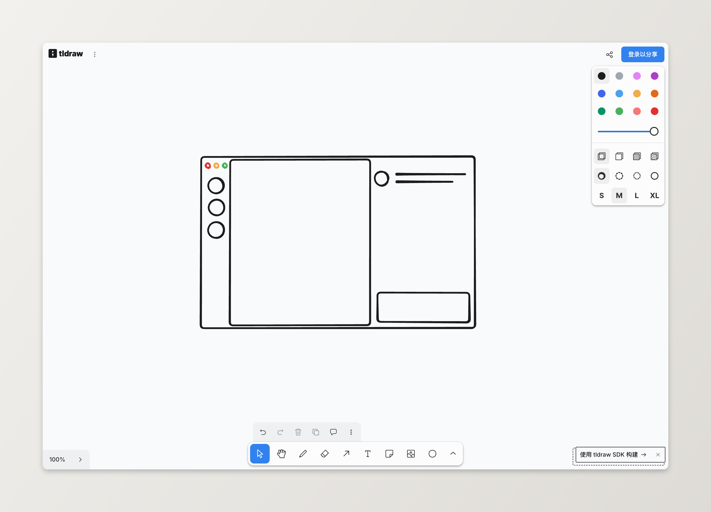
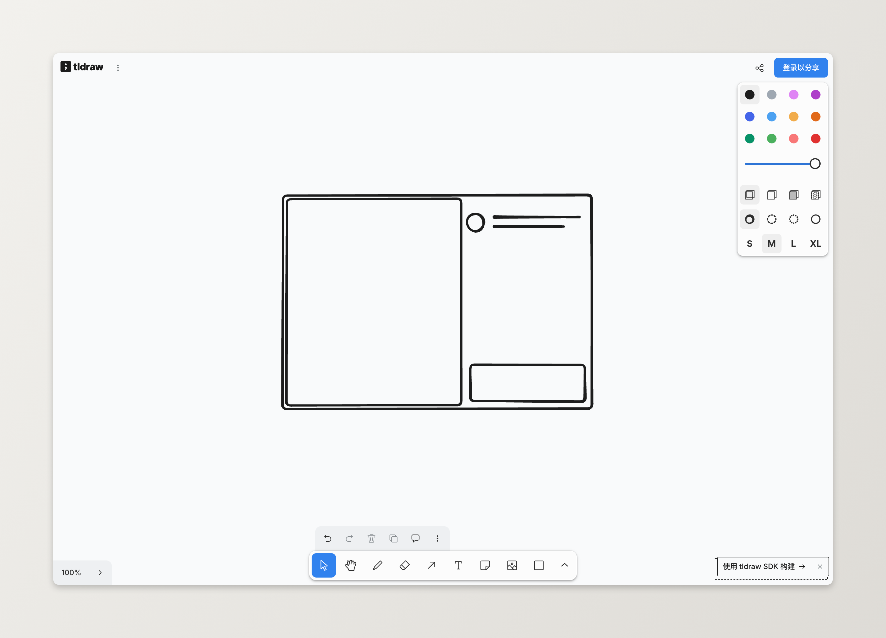
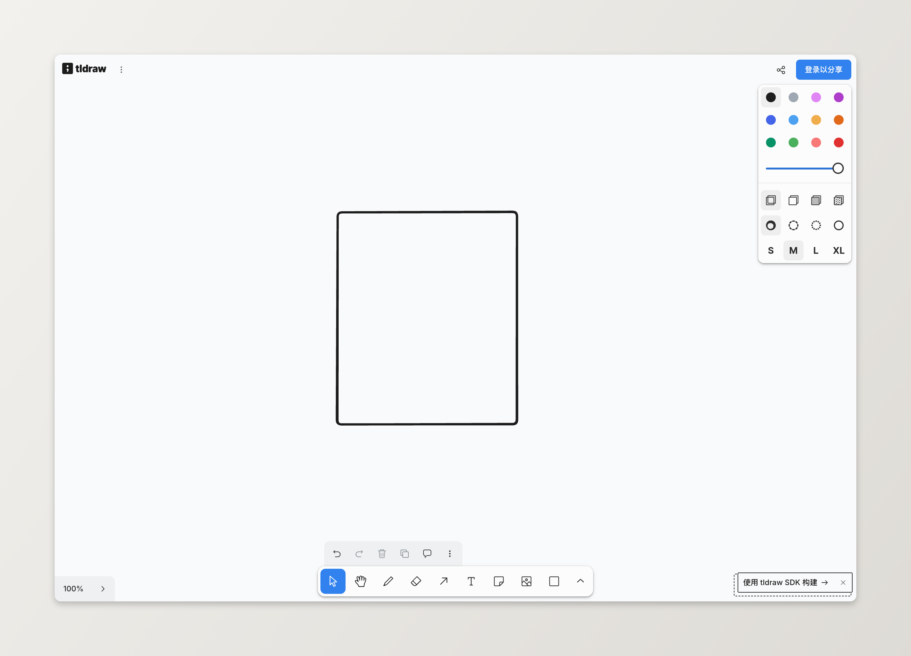
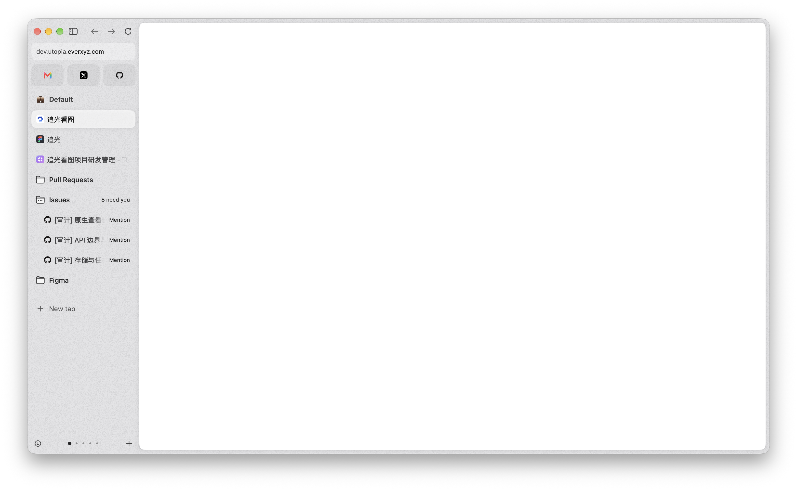

# App shell

This is the layout reference for the Slowpage window. Morris approved it on 2026-11-11. Every later shell change builds this form. The sequence of slices is in `docs/roadmap.md`.

The library form's right region is the chat panel. The reading form's right region is the annotation margin. Those are different regions.

## Pictures

`approved-full-form.png` is the approved library form. Morris picked this text-row sidebar and rejected the icon rail.

`rejected-icon-rail.png` is the rejected alternative. Do not build it.

`sketch-full.png` shows the full form's regions. The left column is the sidebar. The middle is the card. The right column is the chat panel.

`sketch-page-panel.png` shows the reading form's regions. The middle is the page. The right column is the place for the annotation margin. The sketch does not approve what goes inside that column. The rectangle at the bottom of the sketch is not a chat field.

`sketch-page.png` shows immersive reading. The card meets the window edges.

`floating-card-ref.png` is the floating-card reference. A light gray field holds one white card. No rule separates the side column from the card.

The older shots in this folder, `bar-window.png`, `bar-lights.png`, `bar-fullscreen.png`, and `bar-window-main.png`, record the 2026-11-10 bar. They are not the approved shell.

## Window

The base is a light gray field in the macOS vibrancy style. The gray has no approved hex value. Match the field in `floating-card-ref.png` and in `approved-full-form.png`.

The shell draws no divider between the sidebar and the card, between the card and the right region, or across those boundaries. A hairline there fails the shell.

## Card

One white card fills the area between the sidebar and the right region. The card is `#ffffff`. The corner radius is 12 points. The card is inset 6 points from the base on every side, including a side that meets the window because the sidebar or the right region is hidden. A soft shadow sits under the card. The shadow has no approved blur radius. Match the approved picture.

Immersive reading sets the inset to 0 and the corner radius to 0. The card meets every window edge. The gray field is not visible, including at the corners. Immersive reading draws no shadow.

The page, when a book is open, fills the card. The 6 point inset is the gap between the card and the base.

## Forms

| Form | When | Sidebar | Card | Right region | Inset |
| --- | --- | --- | --- | --- | --- |
| Full | Launch, and any time no book is open | Shown | Library | Chat panel | 6 points |
| Page and panel | A book is open | Hidden | The page | Annotation margin | 6 points |
| Immersive | Immersive reading is on | Hidden | The page | Hidden | 0 |

Full is the launch form. The chat panel is open.

Page and panel is the reading form. Opening a book hides the sidebar and replaces the chat panel with the annotation margin. The page uses the reader the app already has.

Immersive reading hides the sidebar, the chat panel, and the annotation margin. Traffic lights still fade in at the top when the pointer is there. That fade is the reading-window rule in `docs/design/north-star.md`. The gray field stays hidden.

## Chat panel

The chat panel exists only in Full. It is 320 points wide and sits on the gray base, outside the card. It is open at launch.

The header shows an avatar, the name **Slowpage**, and the subtitle **你的阅读助手**. The body is the conversation. The bottom is a rounded field. The placeholder is **问问 Slowpage…**.

Shell slices build this frame and the empty state. They do not embed alan, and they do not speak alan's socket protocol. A later change can host alan in this panel. The one-shot `@alan` comment path in `docs/design/north-star.md` stays as written.

Hiding the chat panel widens the card. The card stays inset 6 points from the base. Hiding the chat panel does not enter immersive reading.

## Annotation margin

The annotation margin exists only in Page and panel. It sits on the gray base, outside the card, in the reading form's right region. The chat panel is the library form's right region. Leave the chat field out of the margin.

A highlight, a note, and an agent response each appear as a margin note. The note is anchored to the line it refers to and is vertically aligned with that line. The notes move when the page scrolls, and they move when the page turns. Asking the agent about a selection adds one anchored margin note.

These three layout facts are unset. S3 does not start until Morris approves a mockup that settles them.

- The gap, the connector, and the horizontal position that make a note line up with its line.
- How two notes that want the same vertical band stack.
- How the reader opens the free-form chat while a book is open.

Until that mockup, a shell change does not invent the gap, the stack, or a chat control on the reading form. The control that shows or hides the margin does not open the chat panel. Pull request 14's annotation cards and pull request 29's connector are not this approval.

The margin's width is unset with the rest of that layout. Do not reuse the chat panel's 320 points for it.

## Commands

Launch opens Full. The sidebar is shown and the chat panel is open.

Opening a book from a cover or from **继续阅读** enters Page and panel. The sidebar hides. The chat panel is gone. The annotation margin is shown. The card shows the page at the 6 point inset.

Choosing **全部书籍** closes the book and returns to Full. The sidebar is shown, the chat panel is open, and the card shows the library.

Control-Command-I, written ⌃⌘I, the View menu item, and the toolbar button toggle immersive reading while a book is open. They enter it when it is off, and they leave it when it is on. With no book open, all three do nothing.

Escape leaves immersive reading and does not enter it. Leaving immersive reading returns to Page and panel. The sidebar stays hidden, the annotation margin is shown, and the inset returns to 6 points. Escape does nothing to the form when immersive reading is already off.

The sidebar toggle in Full hides or shows the sidebar. The card keeps the library. The chat panel does not change. The inset stays 6 points. Hiding the sidebar does not open a book.

The sidebar toggle in Page and panel hides or shows the sidebar. The page stays open. The annotation margin does not change. Showing the sidebar does not open the chat panel.

The sidebar toggle is absent in immersive reading. Its menu item does not leave immersive reading.

The panel toggle in Full hides or shows the chat panel.

The panel toggle in Page and panel hides or shows the annotation margin. It does not show the chat panel, and it does not enter immersive reading. The inset stays 6 points. Where that control sits is part of the unset margin layout.

The panel toggle is absent in immersive reading.

When the sidebar is shown, its toggle sits on the sidebar's top row, and the toolbar does not repeat it. When the sidebar is hidden and immersive reading is off, that toggle is the toolbar contents control. Insert it only after the traffic lights are shown, 26 points after the zoom button, centered on that button. Inserting it while the lights are faded parks it on the minimize button.

When the chat panel is hidden in Full, its toggle sits in the toolbar. When the panel is shown, the toggle sits on the panel header, and the toolbar does not repeat it.

## Sidebar

The sidebar is version B. It is 220 points wide. The width does not follow the window size. The rows are text rows. The rejected picture's icon rail is not a collapse state of this sidebar.

The top row holds the traffic lights and the sidebar toggle. The 2026-11-10 centering measurement sizes that row's left inset. The 220 point sidebar width stays fixed.

The inset is the zoom button's right edge plus the close button's left edge, after AppKit has converted those frames to window coordinates. The left gap is the close button's left edge. The right gap is the inset width minus the zoom button's right edge. Those two gaps are equal. Read the buttons after the title bar has laid them out. Measure again when the window is created, when the toolbar style changes, when immersive reading starts or ends, and when the window enters or leaves full screen. A resize does not change the inset. The toggle sits in the remaining part of the 220 point row.

Under that row is a search field. The placeholder is **搜索书名、作者、笔记**.

Then these groups, in this order. Each group label is small and gray.

- **书库** holds **全部书籍**, **正在读**, **想读**, **已读完**, and **PDF**.
- **笔记** holds **高亮与笔记**.
- **书单** holds the reader's lists. Each list has a colored dot. The three lists in the approved picture are examples, not a seeded catalog. An empty group shows the label and no rows.
- **来源** holds connected sources only, as peers. None is primary. The peers are Apple Books, calibre, and each connected folder. A folder row's label is the folder path. Each connected source shows a count. A source that is not connected is omitted. The last row is **+ 添加来源**, and it is always shown.

**设置** is pinned to the bottom of the sidebar, under the groups.

The selected row has a soft gray rounded highlight. Counts are right-aligned. **+ 添加来源** and **设置** have no count.

Icons on the rows come from IconMCP. The parameters are outline, stroke 1.25, and radius 2. A selected row uses the solid variant. The colored dots on **书单** are dots, not icons.

## Library card

The card header shows the selected sidebar title, the count of books in that selection, a sort control, and a view control. The default sort is **最近阅读**. The view S2 ships is the cover grid. No other view is specified.

**继续阅读** sits under the header and above the grid. Each item shows the cover, the title, and the position the reader has already stored for that book. The row lists books the reader has opened. A book with no stored position does not get a fabricated percent.

The grid uses a cover that is 2 by 3. Under each cover, the title and the author are small and gray. A PDF cover shows a PDF mark, as in the approved picture. The books are the ready rows of `Catalog` in `spikes/library`. S2 reads `Book::title`, `Book::author`, and `Book::cover`. S2 does not add calibre write support.

An empty `Catalog` still uses this card. The card offers Apple Books, calibre, and adding a folder as peers. None is a primary button. That empty state replaces the centered shelf buttons.

Choosing **设置** shows settings in the card and stays in Full. The settings page is outside this spec.

## Icons

IconMCP is the only icon library. Outline, stroke 1.25, and radius 2. Solid is for a selected or active state only. The shell rasterizes each SVG at runtime with resvg, as `docs/design/north-star.md` describes.

The sidebar toggle uses the list glyph already shipped for the contents control.

## What S1 removes

S1 removes three temporary paths. It does not repair them.

- The Open button on an empty window.
- The `open -a` and Finder Open With checks. S1 does not make those checks pass.
- The bare shelf screen in `spikes/shell/src/onboarding.rs`. That screen is a white window with **Drop a book to open it**, **Import from Apple Books**, **calibre library**, and **Folder** centered in it.

`spikes/library` stays. `Catalog` is the store S2 draws. The checks in `.cursor/skills/verify-superreader/features/library-shelf.md` describe the bare shelf. S1 deletes those checks with the screen. It does not retarget them at the new card.

## Slices

Each slice is a thin cut of this form. The order is fixed.

1. S1 builds the gray base, the 220 point sidebar, the white card, and the chat panel frame, including empty states. It replaces the bare shelf window and removes the three paths above.
2. S2 fills the card with the cover grid and **继续阅读**, from `Catalog`.
3. S3 builds Page and panel with the existing reader. The sidebar hides, the page is in the card, and the right region is the annotation margin. S3 waits for the margin mockup named above.
4. S4 builds immersive reading.
5. S5 polishes motion. Night mode and a theme switch stay out, under the 2026-11-03 rule. Light and dark join S5 only if a later decision revises that rule.
