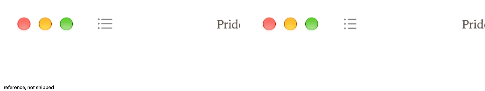

# Contents icon

The shipped glyph is IconMCP `generic` / `list`, outline, stroke 1.25, radius 2. Before is the reading window with `SPIKE_ICON=0`. After draws that icon as the first item in the unified toolbar. AppKit places the item after the traffic lights and centers it on them. On this Mac the gap from the zoom button's trailing edge to the item's leading edge is 26.0 pt, and the vertical delta is 0.0 pt. The image is a template `NSImage` rasterized at runtime with resvg. The SVG is compiled into the binary.

`SPIKE_ICON=sf` draws the SF Symbol `list.bullet` in that same item. That crop is the reference. It is not shipped. The reference item measured 25.0 pt and 0.5 pt, because the symbol image is a different width.

These captures use Books-white `#ffffff`. That color came from a scratch build so the shots match the paper in PR #15. This branch still paints `#f3eee4`.

There is no sidebar, so there is no sidebar crop. The dark-appearance shots of the previous glyph are not the shipped icon. A dark aqua template paints light, and fixing that is a separate change.

Toolbar, 2x, left side.

SF Symbol `list.bullet`, same spot, 2x, beside the shipped crop. The caption says reference, not shipped.

## List candidates

Morris picked A. The sheet stays as the record of that choice. It is `list-candidates.png`, on `#ffffff`, from the real toolbar. Columns are the SF Symbol `list.bullet` (reference, not shipped), the previous `table-of-contents` glyph, then A, B, and C. Rows are the toolbar size at 1x and 2x, then 4x.

| | Set | Name | Query |
| --- | --- | --- | --- |
| A | generic | list | list |
| B | editor | list-bullet | list bullet |
| C | generic | menu | menu lines |

The search SVGs stay in `candidates/`. The shipped file is `assets/icons/list.svg`, fetched with `just icons-fetch`.

