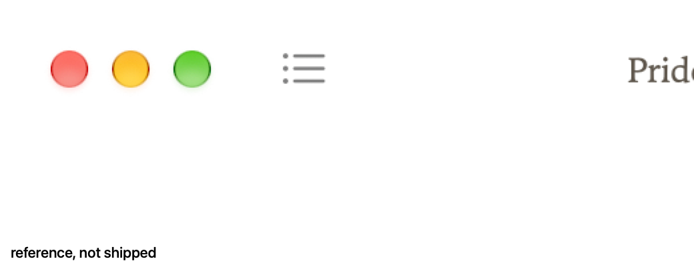
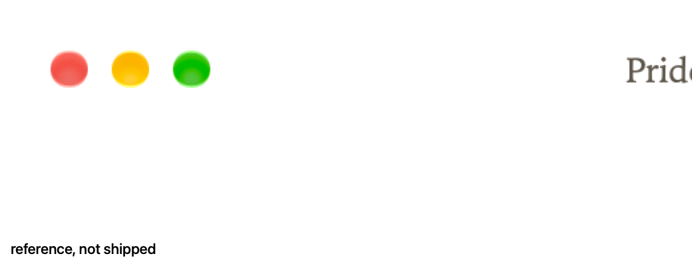
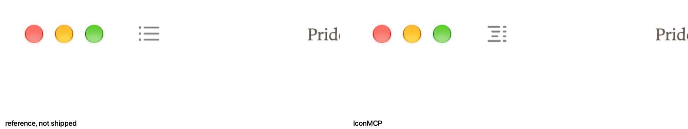
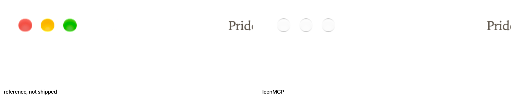
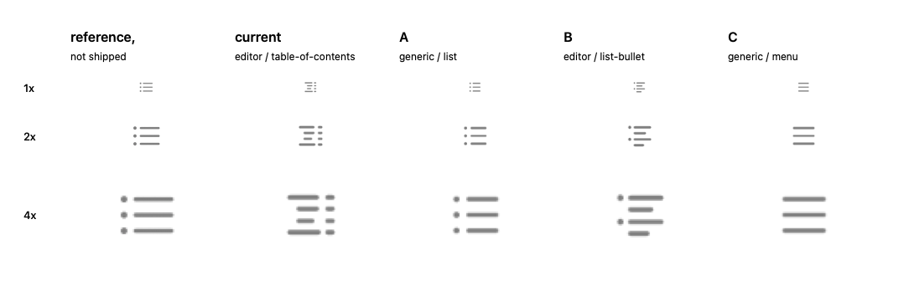

# Contents icon

Before is the reading window with `SPIKE_ICON=0`. After draws the IconMCP contents icon as the first item in the unified toolbar. AppKit places that item after the traffic lights and centers it on them. On this Mac the gap from the zoom button's trailing edge to the item's leading edge is 26 pt, and the vertical delta is 0 pt. The image is a template `NSImage` rasterized at runtime with resvg. The SVG is compiled into the binary.

`SPIKE_ICON=sf` draws the SF Symbol `list.bullet` in that same item. That crop is the reference. It is not shipped.

These captures use Books-white `#ffffff`. That color came from a scratch build so the shots match the paper in PR #15. This branch still paints `#f3eee4`.

`SPIKE_APPEARANCE` sets the window appearance for the shot. Dark aqua paints a template image light, so both glyphs disappear on the white page. There is no sidebar, so there is no sidebar crop.

Toolbar, 2x, left side.

SF Symbol `list.bullet`, same spot, 2x. Reference, not shipped.

Light and dark sheets. Left is the SF Symbol reference. Right is IconMCP.

## List candidates

Morris asked for a simpler list glyph. The shipped icon stays `editor` / `table-of-contents`. The sheet is `list-candidates.png`, on `#ffffff`, from the real toolbar. Columns are the SF Symbol `list.bullet` (reference, not shipped), the current glyph, then A, B, and C. Rows are the toolbar size at 1x and 2x, then 4x.

| | Set | Name | Query |
| --- | --- | --- | --- |
| A | generic | list | list |
| B | editor | list-bullet | list bullet |
| C | generic | menu | menu lines |

The SVGs are in `candidates/`. They are not in `assets/icons` yet.

