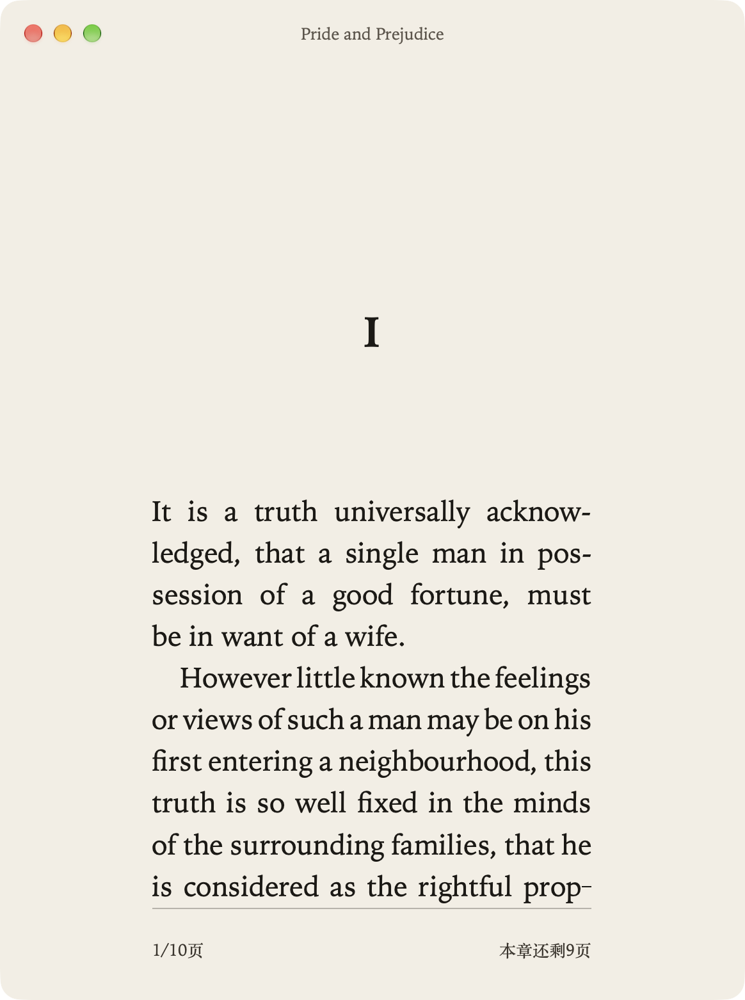
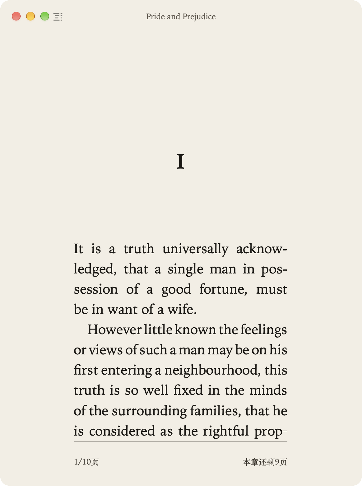
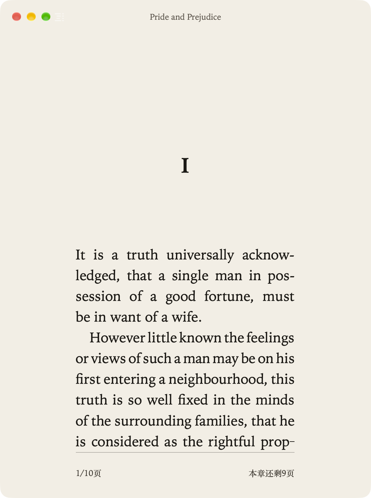
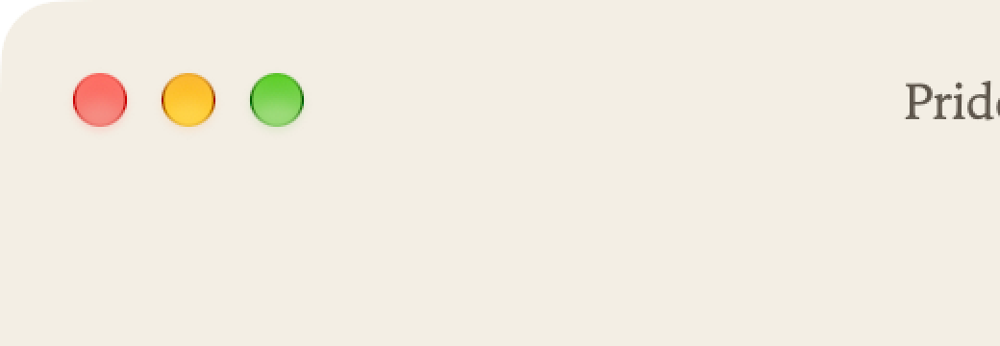
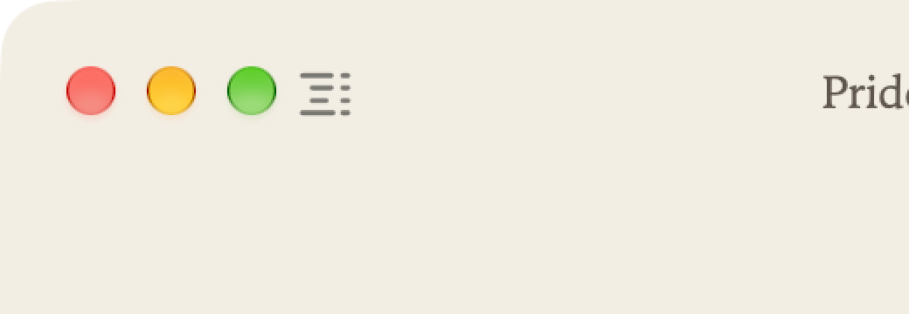
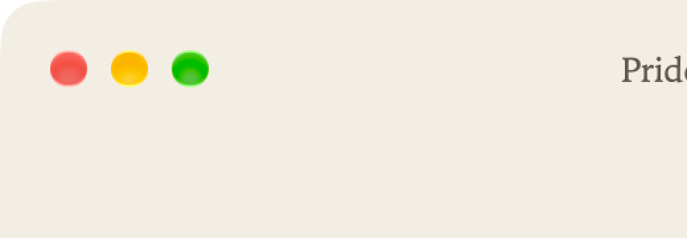
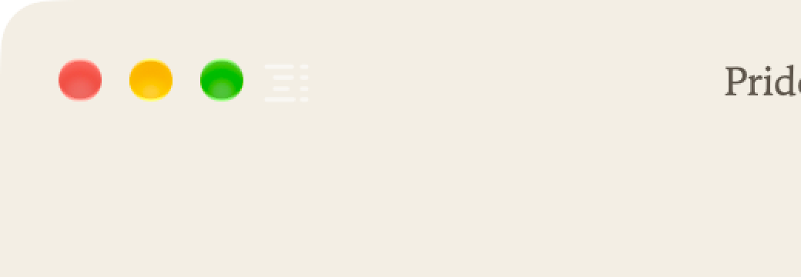

# Contents icon

Before is the reading window with `SPIKE_ICON=0`. After draws the IconMCP contents icon in the toolbar. The image is a template `NSImage` rasterized at runtime with resvg. The SVG is compiled into the binary.

`SPIKE_APPEARANCE` sets the window appearance for the shot. The paper stays `#f3eee4`. In dark aqua the template icon is light, so it is faint on the paper. There is no sidebar, so there is no sidebar crop.

Toolbar, 2x, left side.

