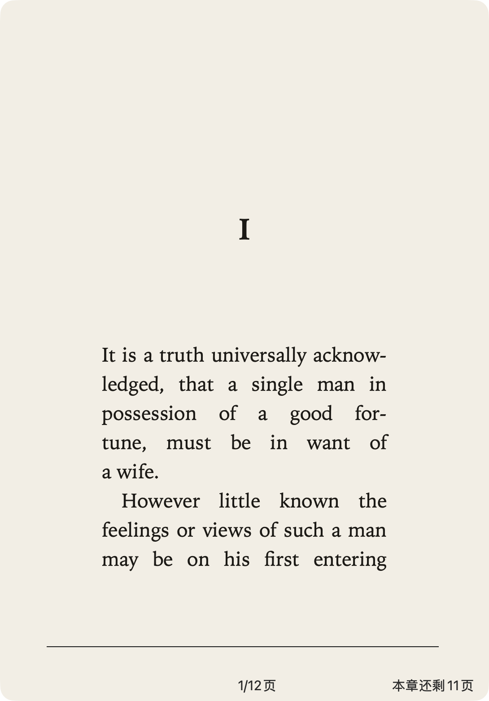
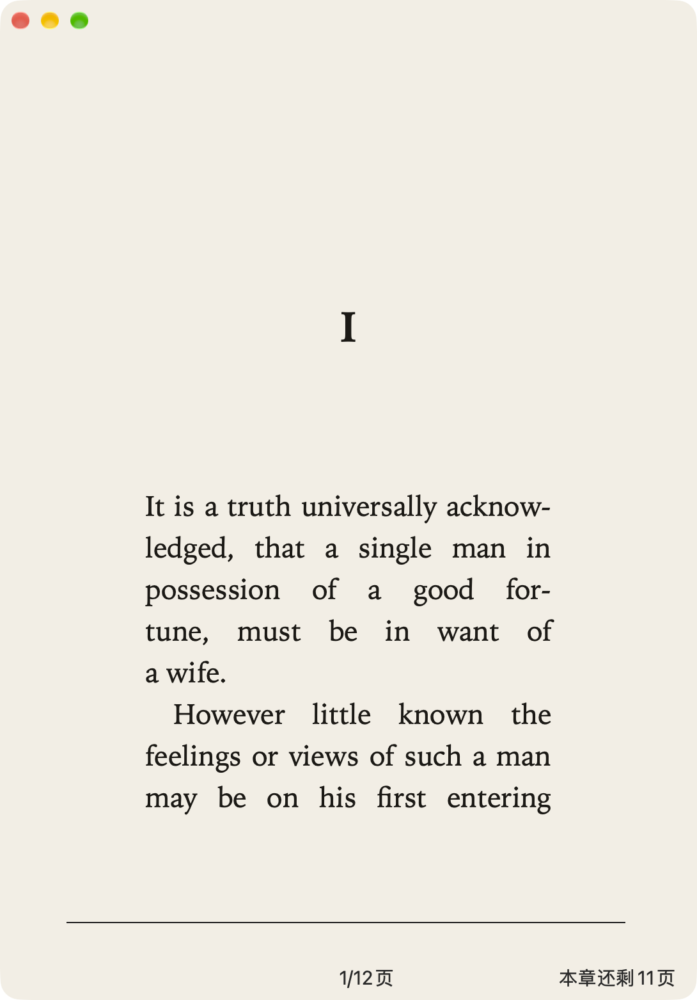
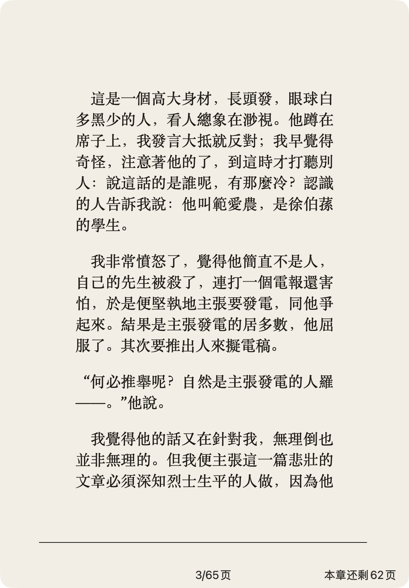
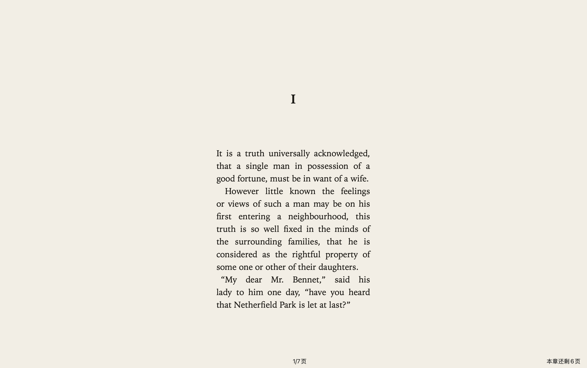
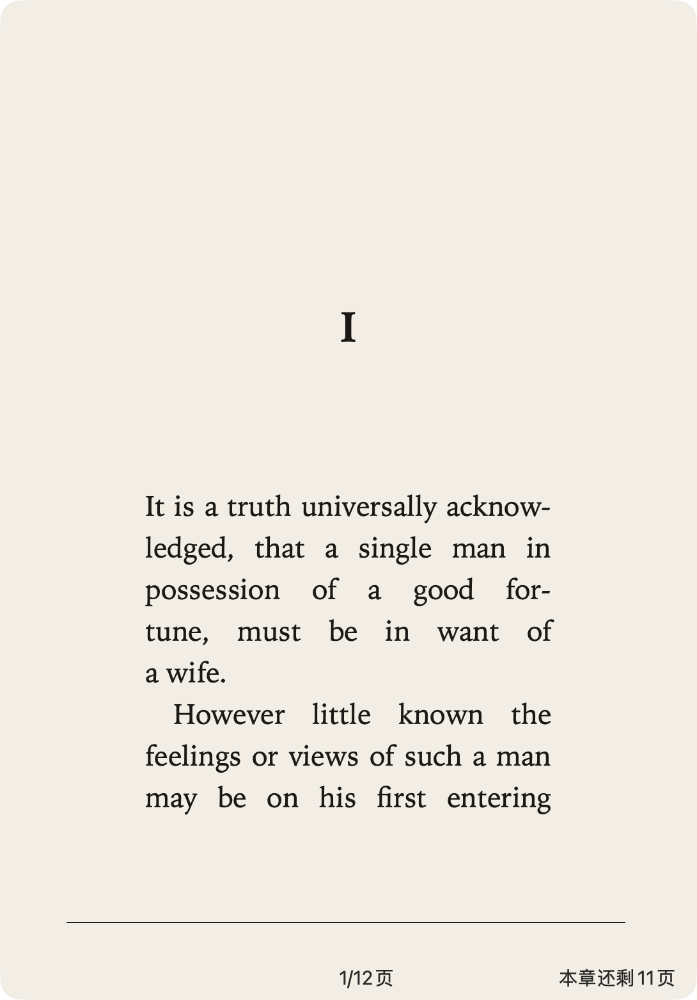
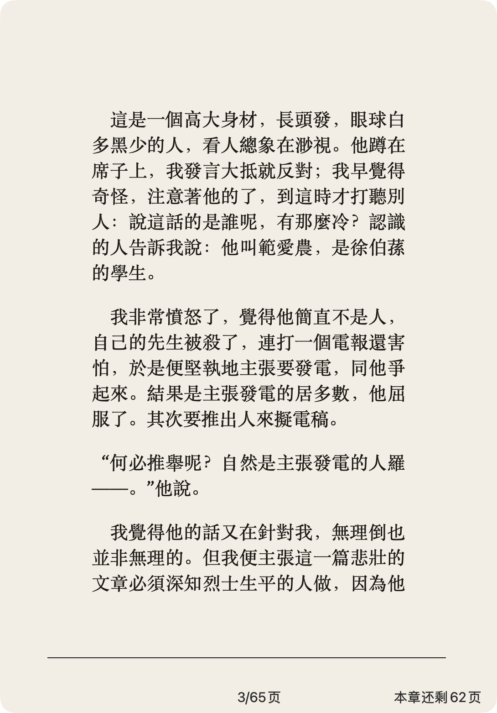
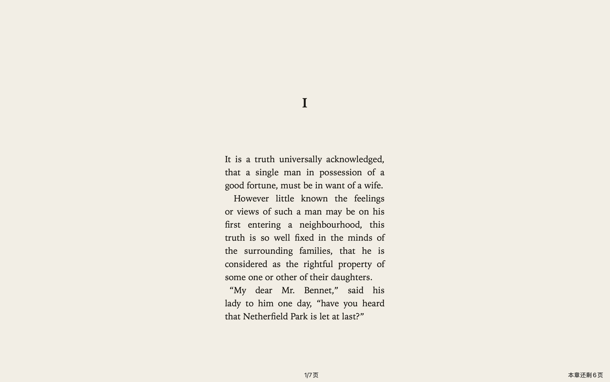
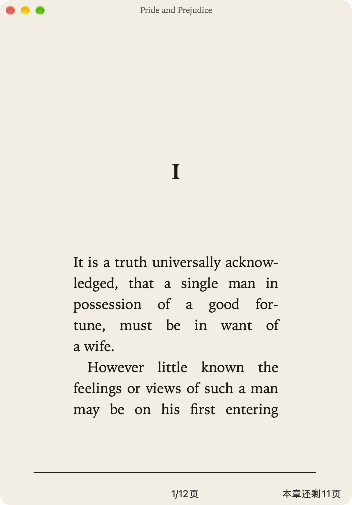
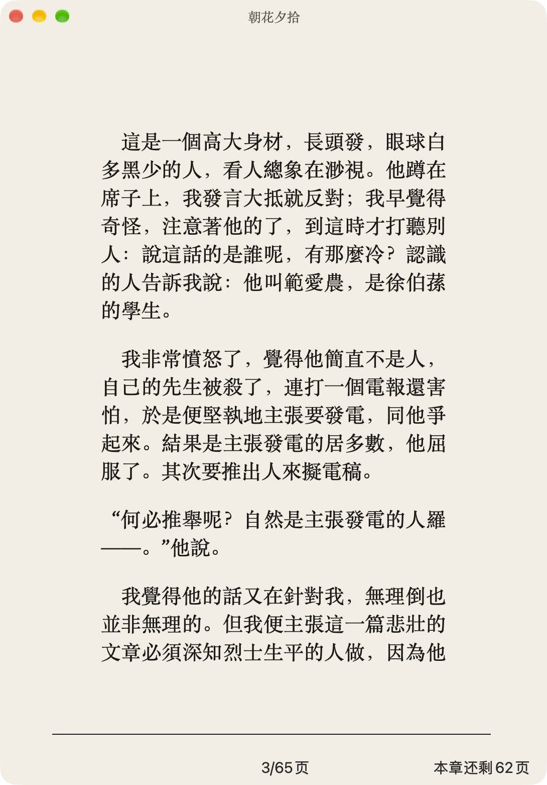
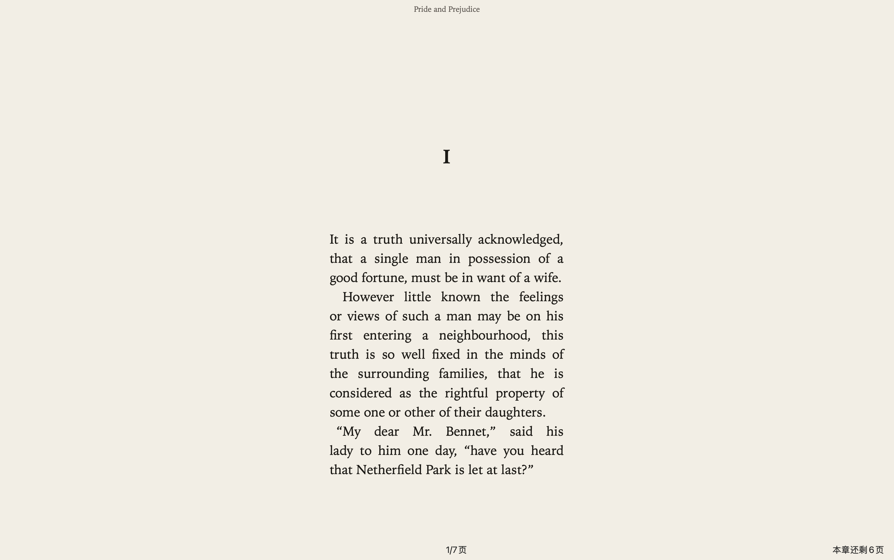

# Window chrome

The reading window should follow the book. The page keeps its trim, a mat sits around it, and the title bar stops looking like a separate application frame. These three prototypes try that. `SPIKE_CHROME` selects one. Unset, the spike keeps the system title bar and the 1100 by 1400 window. None of them is the default.

The paper is `#f3eee4`. The footer stays, and it reads `N/M页` and `本章还剩X页`. Full screen clears any aspect lock, centers the page, and keeps the footer.

## Mats

The side mats are 52 points each. The vertical chrome is also 104 points, so a locked window keeps the page ratio at every scale, not only at the opening size.

A and B put 44 points above the page, 24 below it, and a 36 point footer. 44 points clears the traffic lights, which occupy about 28 points at the top, so the lights sit on the paper and not on the text.

C uses the same 104 points as a 32 point bar, 22 points under the bar, 14 points above the footer, and the 36 point footer.

The opening window is the largest of those that fits in 88 percent of the visible frame. The visible frame already excludes the menu bar and the Dock. 88 percent leaves a rim of desktop, so the window reads as a window. A and B and C open at the same size for the same page. Switching trim, or opening a book that declares its own page size, rebuilds that frame and keeps the top edge.

## The three

| | A `SPIKE_CHROME=a` | B `SPIKE_CHROME=b` | C `SPIKE_CHROME=c` |
| --- | --- | --- | --- |
| Title bar | Transparent, content under the lights. The title is hidden. | Same transparent window. The lights and a 13 point book title fade in together. | A 32 point paper bar. The title stays, centered, in Iowan Old Style or Songti SC. |
| At rest | Paper, page, footer. Lights return when the pointer is in the top 48 points. | Paper, page, footer. Nothing else until the pointer reaches the top. | Lights and the book title stay. |
| Live resize | AppKit locks the content aspect to the opening ratio. | The window is free. The page stays centered and the extra space is split into even margins. | Same lock as A. |
| Full screen | Lock off. Page centered. Footer stays. The system shows the lights at the top of the screen. | Lock was already off. The title still follows the pointer. | The bar stays across the top. The page centers under it. |

NSH 0.3.0 `set_title_bar(Hidden)` sets `titlebarAppearsTransparent`, `fullSizeContentView`, and a hidden title. From Rust it does not set the content aspect ratio, move the window frame (`Window.setFrame` is JavaScript only), paint the window background, clear the titlebar separator, fade the traffic lights, or read the visible frame. The spike does those with objc2 on the `NSWindow` behind the stage.

## Pictures

Paperback. Pride at rest, Pride with the pointer at the top where that prototype has a hover state, 朝花夕拾 at rest, and Pride in full screen.

A.

B.

C.

`a-hover-resize.mp4` is prototype A. The pointer enters the top edge, the lights appear, and the window is dragged from a corner while the aspect stays locked. `b-hover-resize.mp4` is prototype B. The title fades in with the lights, and a free resize keeps the page centered.

## Recommendation

Build B. At rest the window is the page and the footer, which is the immersive part Morris asked for. Reaching the top brings the lights and the book title together, so the title is there when you want the window and absent while you read. A drops the title entirely. C is the closer picture of the Apple Books reference, because that reference keeps the title on screen, and it is the right choice if the title should be visible without a pointer move. C is still paper, and the system title bar is gone. Morris picks. The env var stays off until then.
