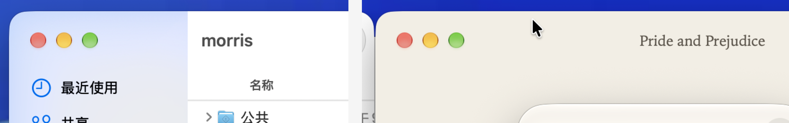
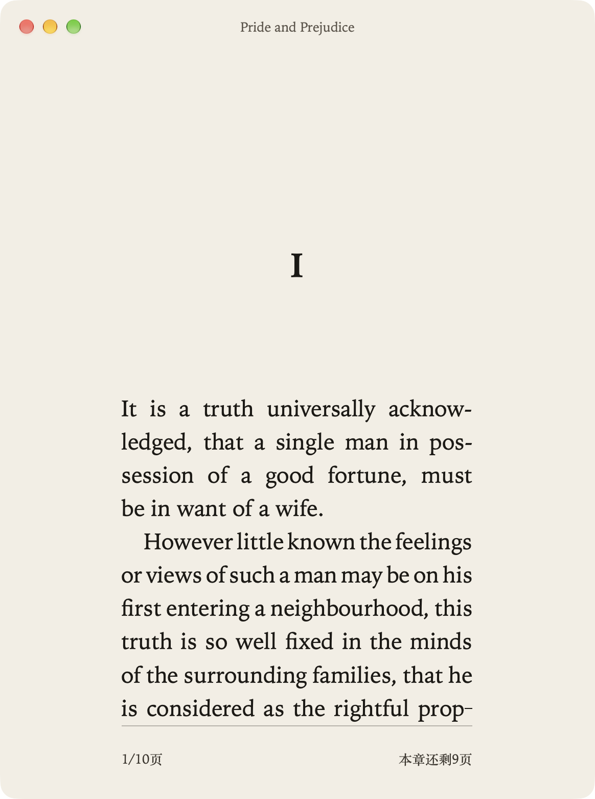

# Window chrome

Morris picked B on 2026-11-04. These notes record that choice. At rest the traffic lights and the book title are hidden. The pointer at the top fades both in. The window background is the paper. Prototypes A and C stay in this folder as the record. They are not in the app. The 2026-11-11 shell in `docs/design/shell/spec.md` is the window plan from here on. It puts this page inside the card.

## The window

The page keeps the trim ratio. A 52 point mat sits on each side, and a 48 point mat sits above the page, clear of the traffic lights. The footer lives in the page's own bottom margin. The rule, the page number, and `本章还剩X页` use the same measure as the text. The column is the space between the top margin and that footer, so a full page ends within one line of the box.

The window opens at 88 percent of the visible frame on the limiting axis. A live resize does not lock the aspect. Extra width becomes even margins. A trim change resizes the window and keeps the top edge. Full screen grows the page to the screen height with the same mats, and the type scales with the page. The page stays centered.

On 2026-11-04, NSH 0.3.0 `set_title_bar(Hidden)` set `titlebarAppearsTransparent`, `fullSizeContentView`, and a hidden title. A height of `None` installed no toolbar. The spike added an empty unified toolbar, the paper window color, a clear titlebar separator, and the full-screen toolbar hide with objc2. NSH 0.4.0 takes the toolbar, the transparent title bar, the surface background, and the full-screen toolbar hide. What remains on objc2, and why, is in `docs/nsh.md`.

## Traffic lights

The buttons are AppKit's `standardWindowButton`. The spike only changes their alpha. On this Mac (`sw_vers` 27.0.1, build 26A434, Xcode 27.1, SDK 27.0) the built binary's `LC_BUILD_VERSION` is platform MACOS, minos 11.0, sdk 27.0. The SDK is current, so the old drawing was not an old link. A window with no toolbar still gets the legacy title-bar slots. macOS 27 puts the current, larger corner and the lower button row on a toolbar window. An empty unified toolbar, with a transparent title bar and no separator, matches Finder and adds no item bar. NSH 0.3.0 sets no appearance and no older-SDK shim that would force the legacy look.

`lights-compare.png` is Finder's corner beside this window, with the pointer at the top.

## What was tried

| | A | B, chosen | C |
| --- | --- | --- | --- |
| Resting state | Lights hidden, no title | Lights and title hidden | Thin paper bar, title always visible |
| Pointer at the top | Lights fade in | Lights and title fade in | No change |
| Resize | Aspect locked | Even side margins | Aspect locked |

Paperback shots below. A and C are the earlier builds. B is the window in the app now.

### A

### B

### C

`a-hover-resize.mp4` is prototype A. `b-hover-resize.mp4` is the chosen window. The pointer enters the top edge, the lights and the title fade in, and a free resize keeps the page centered.
