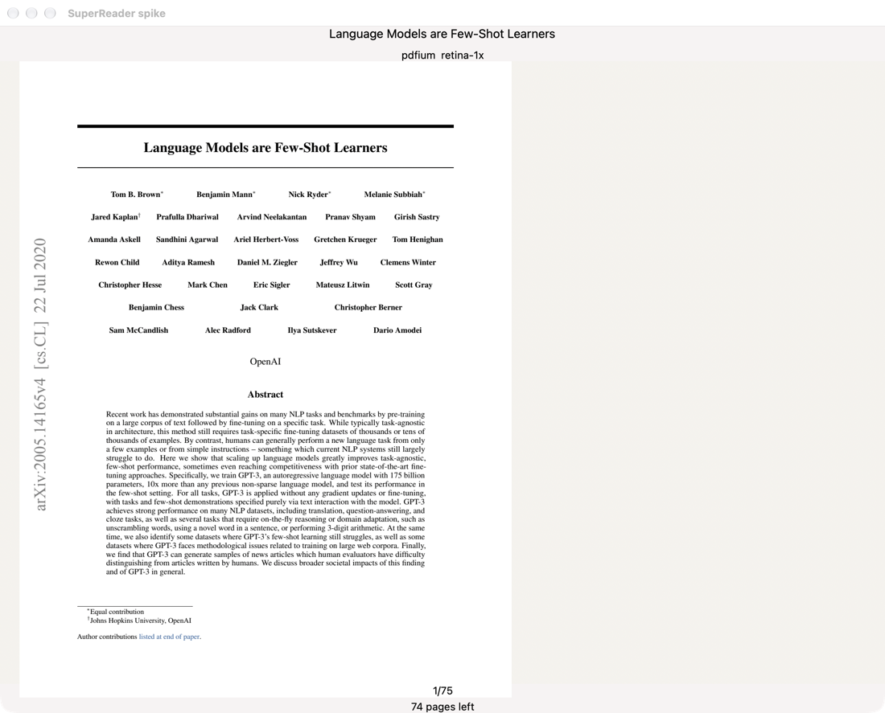
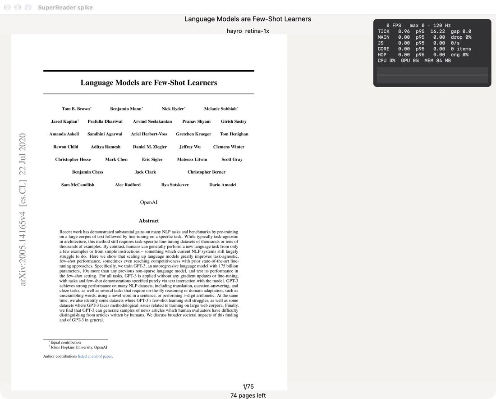
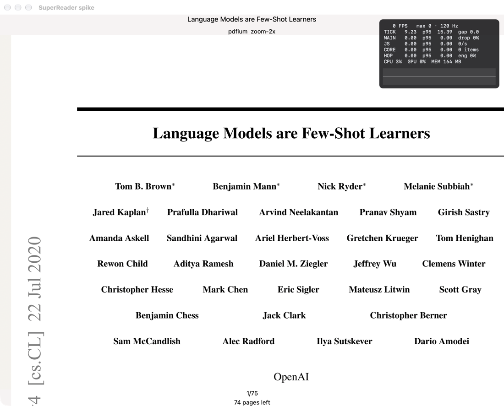
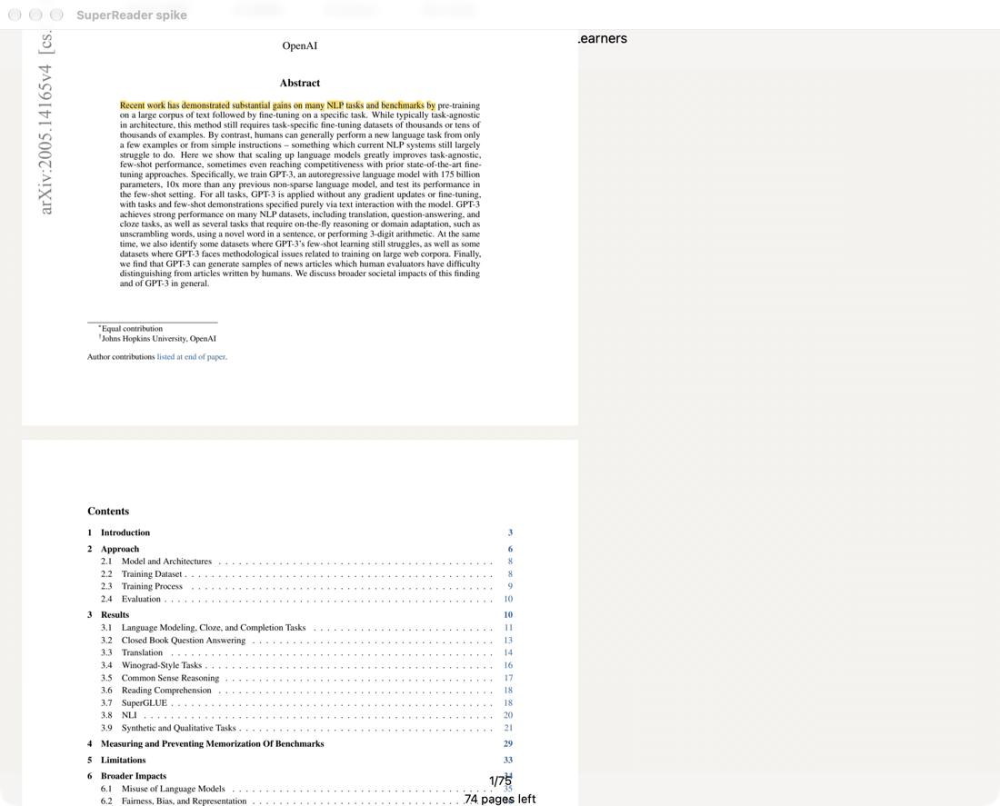
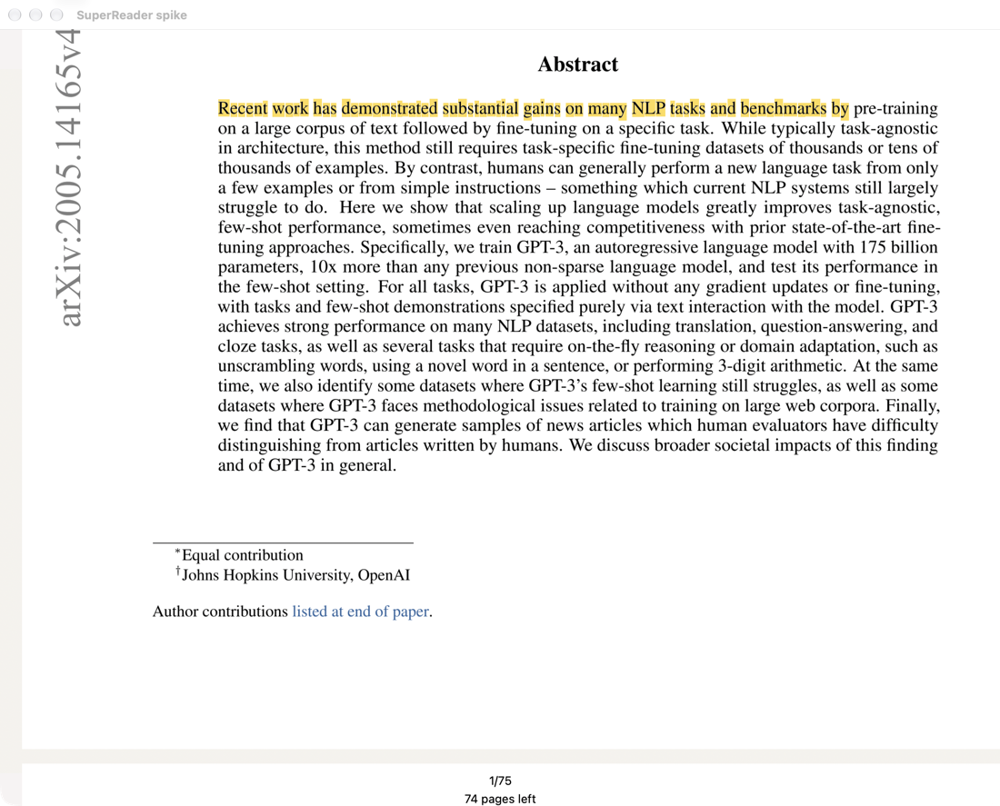
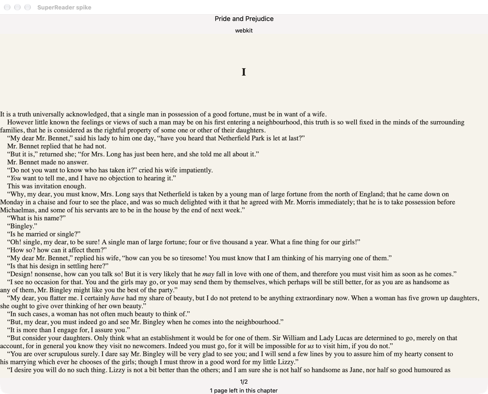
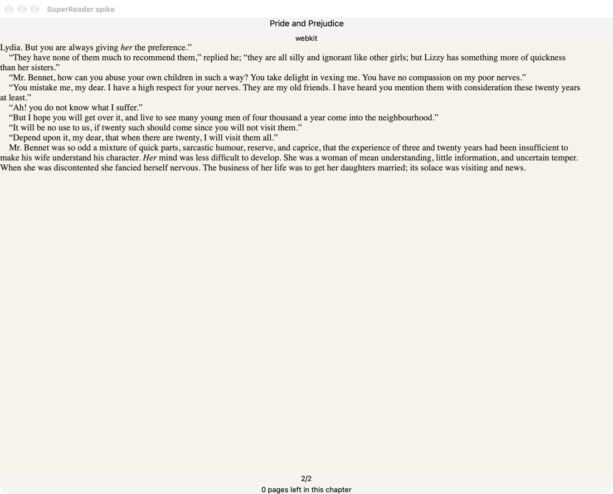
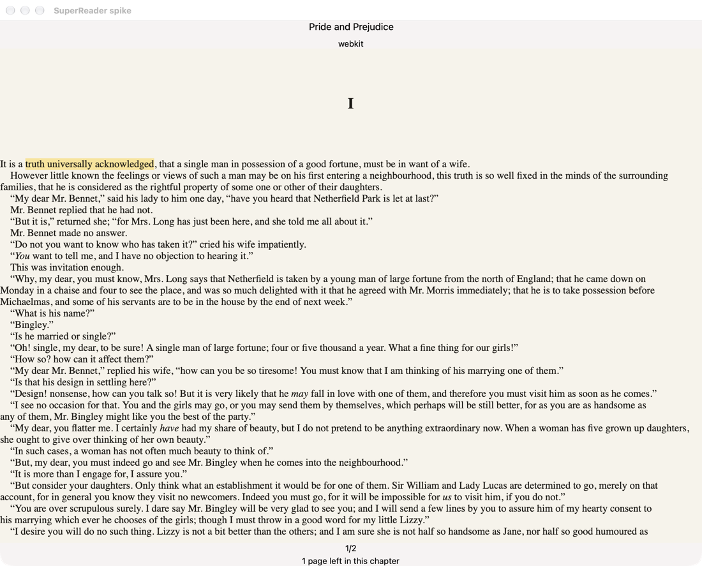
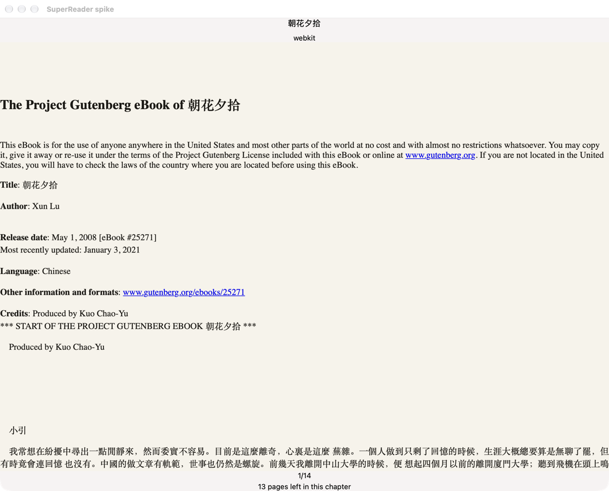
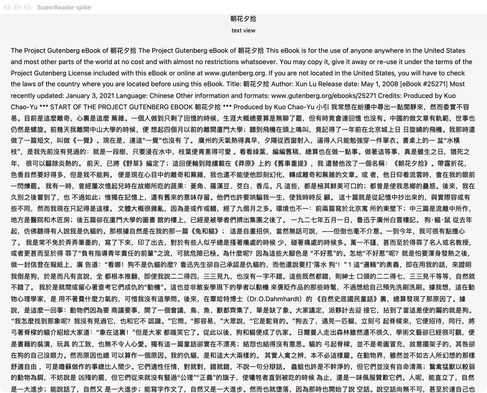

# Spike report

The window is `spike-shell`. The performance overlay is off. PDF timings come from `spike-measure`, which does not link AppKit. It re-execs itself, alternating pdfium and hayro, five release runs at each scale, on the 75-page GPT-3 paper. Every bitmap length is checked against width times height times 4. That campaign ran on Rust 1.93. The window binary is Rust 1.98.1, because `nsh-core` 0.3.0 uses `if let` guards.

Retina 1x is 2 pixels per PDF point, drawn at the page's point size. Zoom 2x is 4 pixels per point, drawn at twice the point size. Changing scale drops the old bitmap. It is not stretched.

Open-to-first is the child clock from `main` through the first raster. Later-page time pools every page after the first across the five runs. RSS is one `ps -o rss` sample after the last page, not a peak sampler. The limiter is the raster. A few pages take 150 ms to 320 ms, so the max is not the typical page.

## PDF, pdfium against hayro

| Engine | Scale | Runs | Open to first, median | First raster, median | Later page, median | RSS median | Phrase hits |
|---|---|---|---|---|---|---|---|
| pdfium | retina-1x | 5 | 51.6 ms, range 39.6 to 118 | 47.5 ms | 9.8 ms, range 0.7 to 294 | 238 MB | 2 of 2 |
| hayro | retina-1x | 5 | 9.5 ms, range 9.1 to 37.9 | 7.9 ms | 17.3 ms, range 1.8 to 321 | 412 MB | 1 of 2 |
| pdfium | zoom-2x | 5 | 51.5 ms, range 46.3 to 59.8 | 47.0 ms | 14.0 ms, range 2.2 to 264 | 344 MB | 2 of 2 |
| hayro | zoom-2x | 5 | 19.2 ms, range 17.7 to 20.0 | 17.6 ms | 18.3 ms, range 4.2 to 158 | 527 MB | 1 of 2 |

The phrases are `Few-Shot Learners` and `GPT-3` on page 0. pdfium returned 2467 tight glyph boxes. hayro returned 2080 and missed one phrase. That hayro hit count is from the campaign extractor, which concatenated glyphs. The gap pass below restores the phrase. The timing row is the same campaign. Errors were 0 after pdfium kept ownership of the file bytes. An earlier run borrowed those bytes, freed them, and failed on page 3. That run is not in the table.

The highlight uses tight character boxes in page points, with the PDF origin flipped to the top of the page, then scaled by the pixel scale. Paper pixels inside a slightly padded band are tinted yellow. Ink darker than the paper is left alone, so the glyphs stay black. A drag from the start of "Recent" through the next line selects both lines. The same anchor is drawn at 1x and at 2x.

Picked on 2026-11-03: pdfium. Its later-page median stays under 16.7 ms, and the boxes are complete enough for a comment. The accepted cost is shipping `libpdfium.dylib`. hayro opens faster and needs no dylib. Its later-page median is over 16.7 ms, and the text gap is below.

## hayro text gap

hayro lost the phrase `Few-Shot Learners` because its text device emits drawn glyphs and does not invent the spaces a PDF leaves as positioning gaps. On page 0 the raw string was `Few-ShotLearners`, 6 spaces against pdfium's 317. `GPT-3` was already present. The title space is not a wide jump between origins. The `t` in Shot advances 5.73pt, and `L` starts 4.30pt after that advance. Letter pairs on the same page stay within 0.5pt of the advance, and a real word space runs at least 2.2pt past it.

A small pass clusters a line so a superscript within 5pt stays on that baseline, then inserts a space when the extra gap is over 1pt. That restores `Few-Shot Learners` and `GPT-3` on page 0. The same check matches one pdfium line on later pages: `Closed Book Question Answering` on page 1, `Recent years have featured` on page 2, and `power-law trend with the` on page 10.

The pass records why hayro lost. It writes 338 spaces where pdfium writes 317. hayro still reports the ligatures fi (11 on page 0) and fl (1) where pdfium expands them to `fi` and `fl`. pdfium also has one U+0002 inside `fine-tuning` that hayro does not emit. Another look is worth it only if shipping `libpdfium.dylib` becomes the problem, and only with those leftovers still open. The later-page median was already over one frame.

## EPUB, WKWebView against Blitz against TextView

WKWebView is a custom `NSView` registered with NSH. It loads `epub://` through a `WKURLSchemeHandler` that serves the zip entries. NSH's own web view cannot load `file:` or a custom scheme. Single-page pagination is CSS columns on the body. The footer is page N/M and the pages left in the chapter.

These open and turn numbers are one launch each, not a five-run median. The turn time is the Rust clock from the turn call until WebKit reports the new page index, so it includes the script round trip.

| Engine | What it showed | Open | Pages | Turn | Anchor |
|---|---|---|---|---|---|
| WKWebView | Pride chapter 1, Standard Ebooks CSS | 300 ms | 2 | 106 ms to page 2 | spine href, character range, text |
| WKWebView | 朝花夕拾, first long spine item | 327 ms | 14 | not turned in this launch | same shape |
| Blitz 0.3.0-beta.4 | same chapters, headless | resolve about 10 to 18 ms | Pride 1, 朝花夕拾 9 vertical slices | slice paint about 3 ms | none |
| TextView | 朝花夕拾 in the NSH window | not separately timed | one scrolling column | none | NSH does not return the selection |

Blitz did not honor `column-width`. The 9 pages are y offsets into one tall column, not publisher columns.

The Pride selection is the range 20 to 50 in `/epub/text/chapter-1.xhtml`, text `truth universally acknowledged`. The window reloads after that message and paints the same range again. The highlight in the screenshot is the mark after that reload.

Picked on 2026-11-03: WKWebView. It keeps the publisher CSS, paginates one page at a time, and the selection survives a reload. The accepted cost is a macOS WebKit view, and one sample turned a page in about 100 ms. Blitz did not paginate. TextView can show a plain chapter, including CJK, and it cannot turn pages or yield an anchor.

## Tests

`cargo test --manifest-path spikes/Cargo.toml -p spike-report -p spike-epub -p spike-pdf` covers the median, the EPUB character range, the pdfium highlight sitting on the ink of `Abstract`, and the hayro gap pass restoring `Few-Shot Learners`. `nsh test` does not see inside a native view, so the page pixels are the window captures above.
